# 📚 Locklish — AI Vocabulary Learning & English Mastery App


An AI-powered English learning app for iOS, featuring intelligent vocabulary extraction from PDFs/documents, SM-2 spaced repetition scheduling, bilingual YouTube video study with word-level karaoke, daily news reading with paragraph-level AI translation, pronunciation scoring via speech recognition, and a complete CEFR A1–B2 grammar curriculum.

> ### 🧑‍💻 Về dự án — A Vibe-Coded Personal Product
> Đây là **sản phẩm cá nhân được vibe coding** — toàn bộ app được xây dựng qua quá trình **lập trình hội thoại cùng AI (ZCode + GLM)**, từng tính năng sinh ra từ chính nhu cầu học tiếng Anh **mỗi ngày** của tác giả, theo đúng ý tưởng và thiết kế cá nhân, nhằm **nâng cao chất lượng học tập** của bản thân.
>
> *This is a **personal vibe-coded product**: the entire app was built through conversational AI pair-programming, where every feature originated from the author's own daily English-learning needs and personal design decisions — created to improve his own study quality. The repo also serves as a real-world showcase of the vibe-coding workflow: idea → prompt → AI implementation → verification on simulator & device.*

> **Dự án cá nhân phục vụ mục đích học tập và nghiên cứu.** 
> *A personal project built for learning and research purposes.*

## 📺 Video Demo
Experience the smart import, karaoke subtitles and bilingual news reading in action:

<div align="center">
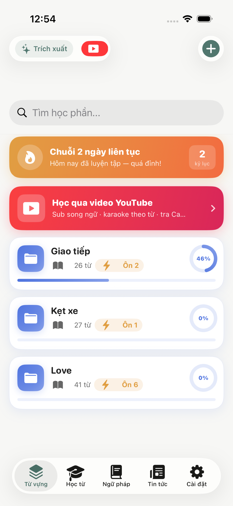 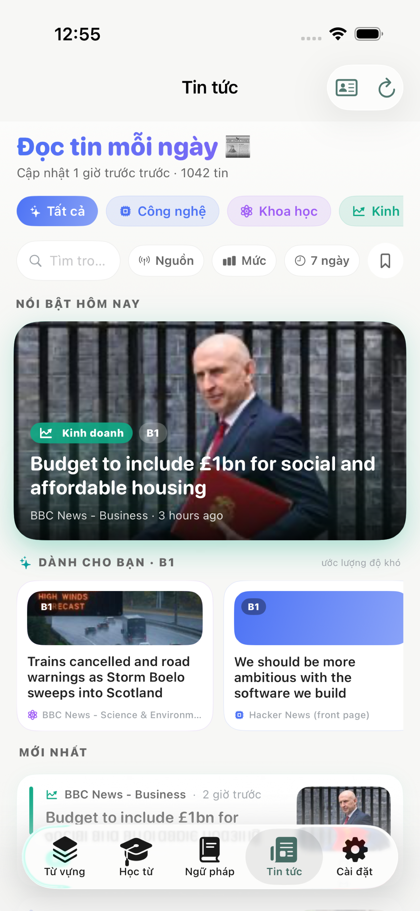 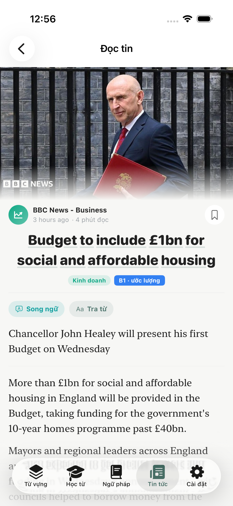 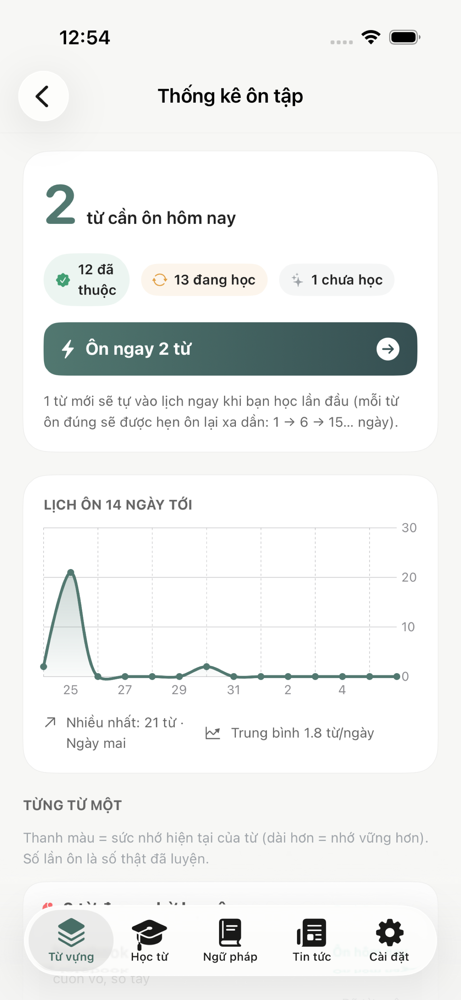
</div>

> **Coming Soon** — Demo video showcasing AI import, word-karaoke YouTube study, and speaking practice...

---

## ✨ Key Features

* **AI Vocabulary Import:** Extract vocabulary from pasted text, PDFs and CSV files (Anki/Quizlet/Excel) — a normalization engine auto-detects pre-compiled word lists (100% capture, user meanings preserved) or lets Gemini AI pick high-value single words from articles, with strict response-schema contracts and hard post-validation filters.
* **SM-2 Spaced Repetition Engine:** Every graded answer (flashcards, dictation, speaking, games) reschedules reviews right before the forgetting point (1 → 6 → 15 → 30+ days), with per-folder statistics: a 14-day "mountain" forecast chart, day-by-day review schedule, and per-word memory-strength bars.
* **YouTube Bilingual Study:** Paste any link to get synchronized EN–VI subtitles with **word-level karaoke tracking** driven by real YouTube word timings; tap any word for instant Cambridge Dictionary lookup and 1-tap save to a deck.
* **Daily News Reader:** 24 verified RSS sources (BBC, NYT, VOA Learning English, Hacker News, NASA…) with full-text extraction including inline images in original order, a zoomable fullscreen image viewer, and **accurate paragraph-level bilingual translation** (one Gemini batch request per article, cached offline).
* **Speaking Practice (Speak & Check):** en-US speech recognition scores pronunciation word-by-word (filler removal, inflection tolerance) and **auto-stops when you've said enough** — results feed straight back into the SM-2 schedule.
* **Grammar & IPA Curriculum:** CEFR A1–B2 roadmap timeline with per-phase progress, 28 full lessons (formulas, bilingual examples, common mistakes, multi-answer exercises) and a 44-sound IPA table with UK/US voice toggle.
* **Ecosystem Extras:** Home-screen widget ("X từ cần ôn"), daily review reminder, learning streak 🔥, iCloud sync (SwiftData + CloudKit), CSV export, iPad/landscape two-column layouts, onboarding flow.

---

## 📸 Screenshots — Toàn bộ màn hình

| | | |
|:---:|:---:|:---:|
| **Từ vựng** | **YouTube catalog** | **Trích xuất AI** |
|  | 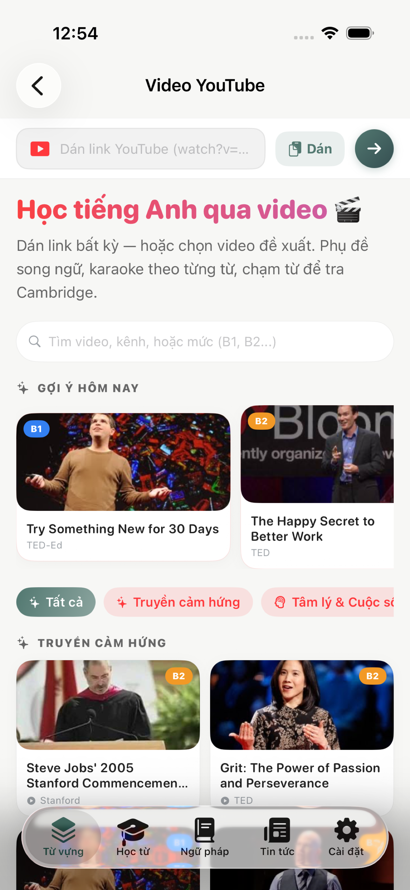 | 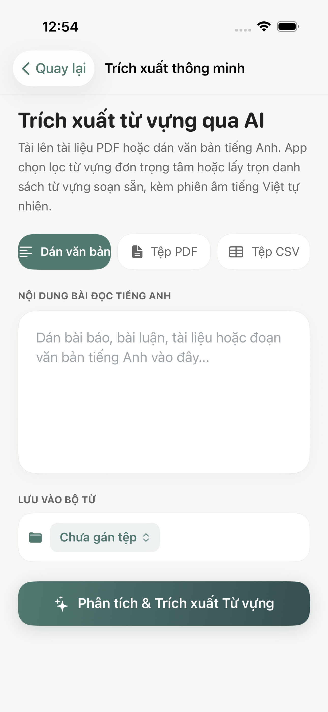 |
| **Chi tiết học phần** | **Thống kê SM-2** | **Luyện nói** |
| 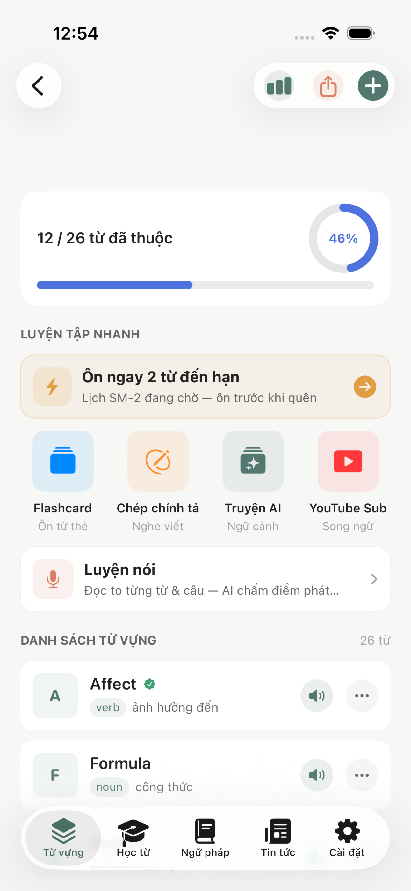 |  | 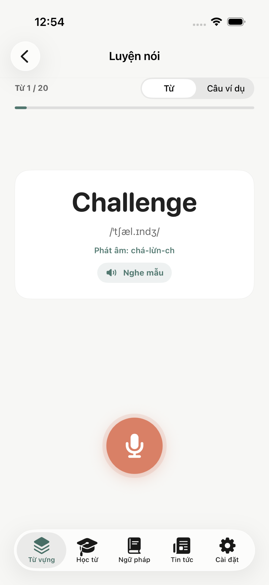 |
| **Lộ trình ngữ pháp** | **Bài học ngữ pháp** | **Bảng IPA** |
| 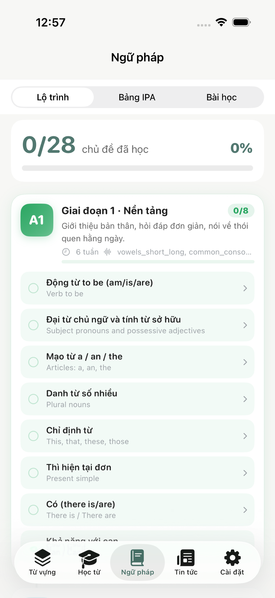 | 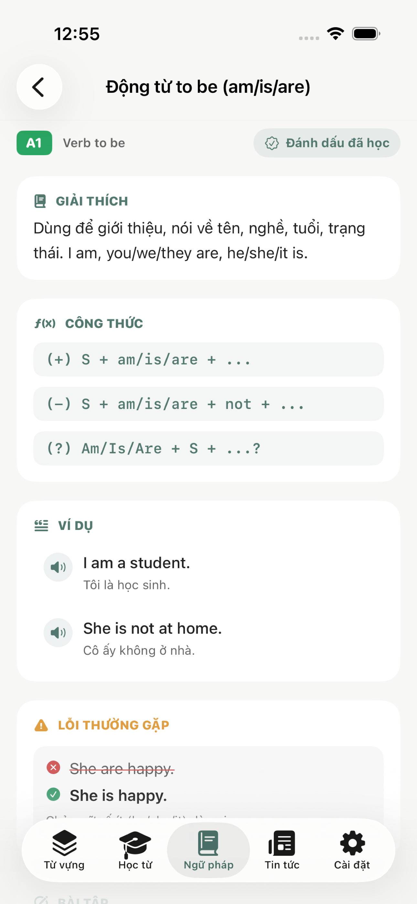 | 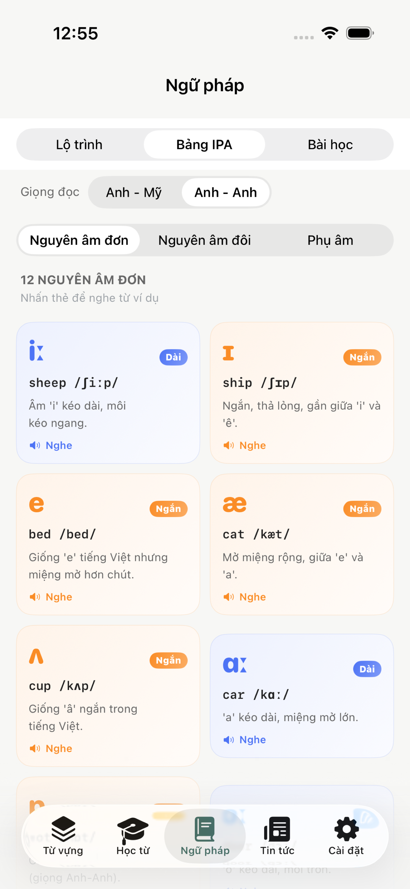 |
| **Bảng tin** | **Đọc song ngữ** | **Bản đồ học từ** |
|  |  | 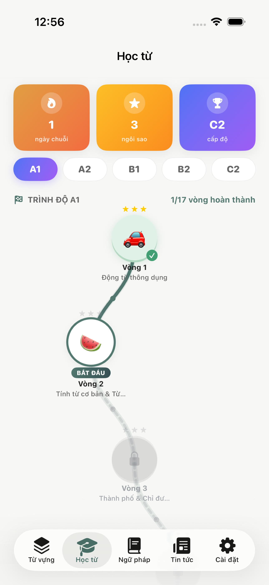 |
| **Cài đặt** | | |
| 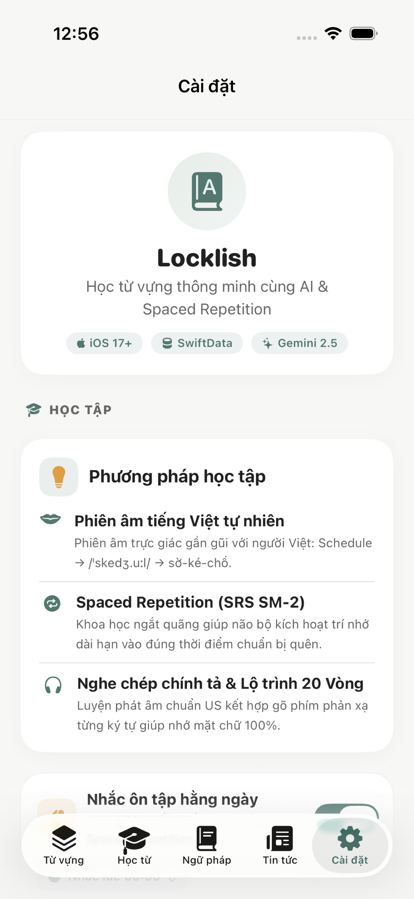 | | |

---

## ⚙️ Architecture & How It Works

**1. Import & Data-Cleaning Layer**
The pipeline that guarantees every word entering the dictionary is clean:
- **Text Normalizer:** shared Unicode cleanup (NBSP, soft hyphens, ligatures, curly quotes) applied identically to pasted text and PDF extraction
- **List Parser:** detects pre-compiled word lists, strips phonetic annotations out of meanings, filters section headers, digits and ASCII-spelled Vietnamese words
- **AI Contract:** Gemini is forced into a strict JSON schema (single English words only, no phrases/names/Vietnamese) — then a deterministic post-validator re-checks every AI answer

**2. Learning Engine Layer**
Spaced repetition and habit systems:
- **SM-2 Scheduler:** ease factor, interval and next-review computation on every graded attempt; due queue balancing across practice modes
- **Progress Tracking:** review counts, streak service, per-deck statistics computed in a single pass over items
- **Habit Surfaces:** WidgetKit timeline (hourly entries + 2-hour refresh policy), local notifications with real due counts

**3. Media Learning Layer**
- **YouTube Engine:** WKWebView player with a ~6 Hz JS time bridge + client-side time projection, human-made caption-track preference, word-level timings from timedtext (JSON3/XML) for true karaoke, disk-cached subtitles for offline re-watching
- **News Engine:** concurrent RSS fetching (ETag/304 caching, retries, per-source failure isolation), a 3-tier full-text extractor (JSON-LD `articleBody` → ordered `<p>`+`` blocks → reader-service fallback for JS-rendered sites), difficulty estimation and grammar-hint detection

**4. Speech Layer**
- **TTS:** AVSpeechSynthesizer with en-US/en-GB voices; karaoke narration driven by the synthesizer's own `willSpeakRange` callbacks (no time estimation)
- **Recognition:** SFSpeechRecognizer streaming with RMS mic-level animation; scoring uses ordered word alignment with stemming tolerance and filler filtering

**5. Data & Sync Layer**
- **SwiftData + CloudKit:** CloudKit-compatible schema (defaults, inverse relationships, no unique constraints), one-time store backup before migration, and a 4-stage container fallback that never crash-loops
- **App Group Sharing:** widget snapshot as a JSON file in the shared container (more reliable than UserDefaults suites on simulators)

**6. UI Layer**
- **SwiftUI + MVVM** with a bento-gradient design system (per-topic color identity, 20pt continuous corners, gradient pills), adaptive two-column layouts on regular width (iPad/landscape)

---

## 🛠 Tech Stack

| Category | Technologies |
|----------|-------------|
| **Language / UI** | Swift 5, SwiftUI (iOS 17+) |
| **Data** | SwiftData, CloudKit (iCloud Sync), App Group |
| **AI** | Google Gemini API (JSON mode + responseSchema, batch translation) |
| **Speech** | AVSpeechSynthesizer (TTS), SFSpeechRecognizer (STT) |
| **Media** | PDFKit, WebKit (YouTube player bridge), XMLParser (RSS/Atom) |
| **Widget** | WidgetKit, TimelineProvider |
| **Notifications** | UserNotifications (daily review reminders) |
| **Charts** | Swift Charts (14-day forecast) |
| **Project** | XcodeGen (`project.yml`), Xcode 16+ |

---

## 🚀 Getting Started

### Prerequisites
- macOS with Xcode 16+
- iOS 17+ simulator (or a real device for speech features)
- Google Gemini API Key *(optional — the app runs fully without it)*
- [XcodeGen](https://github.com/yonaskolb/XcodeGen) *(only when editing `project.yml`)*

### Installation

**1. Clone the repository:**
```bash
git clone https://github.com/thanhnguyen221/Locklish.git
cd Locklish
```

**2. Open the project:**
```bash
open Locklish.xcodeproj
```

**3. Run on simulator:**
Select the **Locklish** scheme → choose an iPhone simulator → `⌘R`.

**4. (Optional) Run on your iPhone — free, no Developer account:**
Select the **Locklish-Personal** scheme → Signing & Capabilities → Team: your personal Apple ID → Run. *(7-day signing; iCloud sync disabled on this scheme.)*

**5. (Optional) Enable Gemini AI:**
Launch the app → **Cài đặt → AI & Dịch dụng** → paste your Gemini API key to unlock AI extraction and accurate bilingual news translation.

---

## 📱 Core Features Walkthrough

### 🤖 AI Vocabulary Import
- Paste text / import PDF / import CSV (Anki, Quizlet, Excel)
- Auto-detects pre-compiled lists — 100% capture with your own meanings
- AI mode picks focused single words with schema-enforced cleanliness

### 🧠 Spaced Repetition
- SM-2 scheduling across flashcards, dictation, speaking and games
- 14-day forecast chart + day-by-day review plan per folder
- Home-screen widget, daily reminder and streak tracking

### 🎬 YouTube Study
- Bilingual subtitles synced to real video audio
- Word-level karaoke underline, tap-to-lookup Cambridge dictionary
- 22 curated videos across 5 topics with daily rotation picks

### 📰 News Reader
- 24 verified sources, topic/source/level/time filters + search
- Full-text reading with inline images and zoomable viewer
- Paragraph-level bilingual mode (Gemini batch, offline cached)

### 🎤 Speaking Practice
- Word-alignment pronunciation scoring with auto-stop
- Word and example-sentence modes, native audio samples
- Scores feed directly into the SM-2 schedule

### 📖 Grammar & IPA
- CEFR A1–B2 roadmap with per-phase progress tracking
- 28 lessons: formulas, bilingual examples, common mistakes, exercises
- 44-sound IPA table with UK/US accent toggle

---

## 📊 Project Structure

```
Locklish/
├── App/                       # Entry point + ModelContainer (4-stage fallback)
├── Models/                    # SwiftData: VocabularyItem, Deck, DailyPracticeRecord
├── Services/                  # Business logic layer
│   ├── ImportTextNormalizer + CSVImportService     # Import pipeline
│   ├── LocalVocabularyExtractorService             # List parser + validator
│   ├── GeminiService                                # AI extraction + batch translation
│   ├── SRSEngine + StreakService                    # Learning engine
│   ├── NewsService + NewsFullTextService            # RSS + full-text extraction
│   │   + ArticleTranslationService                  # Bilingual translation
│   ├── YouTubeSubtitleService                       # Captions + word timings
│   ├── TTSService + SpeechRecognitionService        # Speech layer
│   └── WidgetDataStore + ReviewReminderService      # Habit surfaces
├── ViewModels/                # MVVM view models
├── Views/                     # SwiftUI screens
│   ├── Vocabulary/  Practice/  YouTube/  News/  Grammar/  Settings/
├── Widget/ + Shared/          # Widget extension + shared snapshot
├── Resources/                 # grammar_data.json, news_sources.json, Assets, PrivacyInfo
├── AppStoreScreenshots/       # 6 real screenshots (captured via XCUITest)
├── project.yml                # XcodeGen project spec
├── ROADMAP.md                 # P0–P4 plan with per-item status
├── RELEASE.md                 # Release checklist (TestFlight, IAP, audit)
└── CHANGELOG.md               # Detailed development log
```

---

## 🔐 Security & Privacy Features

- **No Data Collection:** zero analytics, zero tracking — declared in `PrivacyInfo.xcprivacy`
- **On-Device Storage:** all learning data stays in SwiftData on the user's device (or their own iCloud)
- **API Key Safety:** the Gemini key is entered by the user in-app and stored locally in UserDefaults — never hardcoded, never shipped
- **Copyright-Safe News:** only titles, short summaries and links are stored from feeds; full text is fetched on demand for personal reading with source attribution and an "open original" link
- **Crash-Safe Storage:** one-time store backup before schema migrations + graceful 4-stage container fallback

---

## 🦾 Research Context

This project was developed as an independent research project (alongside scientific research at Kien Giang University), exploring:
- Spaced repetition science (Ebbinghaus forgetting curve, SM-2 algorithm) applied to mobile learning
- LLM integration in mobile apps through structured output (JSON schema contracts) and deterministic post-validation
- Speech pronunciation assessment using word-level alignment and edit distance
- Adaptive UI systems (bento-grid design, per-topic color identity) for learner engagement

---

## 📄 License

Copyright (c) 2026 Thanh Nguyen-Nhut. Tất cả quyền được bảo lưu — dự án dành cho mục đích cá nhân, học tập và nghiên cứu.

*Copyright (c) 2026 Thanh Nguyen-Nhut. All rights reserved — intended for personal, educational and research purposes only.*

---

## 👨‍💻 Author

**Thanh Nguyen-Nhut**
- **Role:** iOS Developer / AI Integration Specialist
- **Responsibilities:** SwiftUI App Architecture, Gemini AI Integration, Speech Recognition & TTS, YouTube Caption Engine, Spaced Repetition System, Widget & iCloud Sync
- **GitHub:** [@thanhnguyen221](https://github.com/thanhnguyen221)
- **LinkedIn:** [Thanh Nguyen](https://linkedin.com/in/nhut-thanh-nguyen-6041343b2)
- **Email:** thanhfff55@gmail.com

---

<p align="center">
  Vibe-coded with ❤️, ☕ and AI | Locklish 📚
</p>
